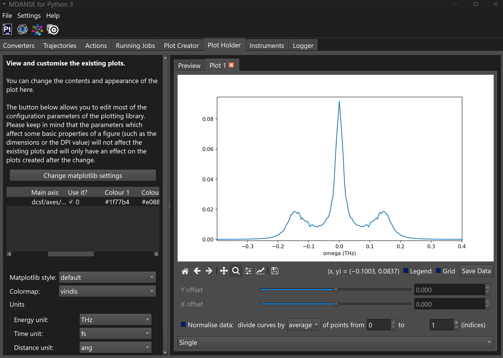

# Answers

## Question 1:
The spectrum will be formed of three Lorentzians, one central peak
which is the known as the Rayleigh peak which corresponds to the 
thermal diffusivity mode and two symmetric peaks shifted 
by $\pm c_s q$ which are known as the Brillouin doublet and correspond 
to the acoustic modes.

## Question 2:
Using the smallest value of $q$ a sound speed of around 915 m/s, we 
disagree somewhat with the experimental results but this is expected
since looking at the spectra

    

we can see that the following equalities 
$\gamma D_{T} q^2 \ll c_s q$ and $\Gamma q^2 \ll c_s q$ 
were not satisfied. To obtain a better agreement with experiment a 
much larger and longer system would be required and $S(q,w)$ 
so a smaller value of $q$ can be used. 
